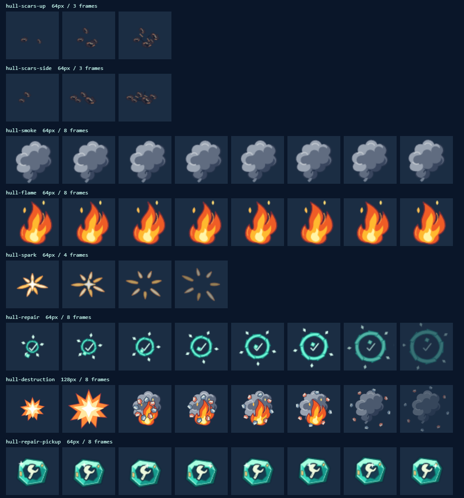

# Sistema de casco e APK de teste

O BULLET WAKE recebe uma regra de sobrevivência com quatro segmentos, danos visuais progressivos e reparos físicos. A regra clássica continua disponível. As duas modalidades compartilham o mesmo mundo e usam categorias de recordes separadas. O APK de teste inclui o build de produção e os recursos necessários para execução offline.

**Veredito: aprovado com ressalvas para revisão e playtest.** Automação não substitui balanceamento com pessoas nem validação em Android e controles físicos.

## 1 Estado do Git

Branch inicial: `feat/bullet-wake-evolucion-definitiva`, em `ecd0e29`, com alterações de cena, HUD, cronograma, áudio, entrada, testes e capturas ainda não commitadas. A `master` local/remota estava em `90c4966`.

O histórico já continha `balance/fenda-stage-progression` (`5156844`) e `feat/supply-drone-carrier` (`842f962`), além de `6d020bf`, `2317f9d`, `2e7ea6c`, `1d41dd0`, `9532603`, `dd52ac8` e `ecd0e29`. A consolidação foi concluída em **`2060204247f800ee2e25af83f4da7ed46cf3bdb2`**. A `master` avançou por fast-forward, recebeu push normal e teve SHA remoto conferido por `git ls-remote`. Nenhum force push, descarte ou merge cego foi usado.

Os workflows desse commit passaram: [base web](https://github.com/emersonbarrosdev/BULLET_WAKE/actions/runs/44668551015) e [inspeção visual](https://github.com/emersonbarrosdev/BULLET_WAKE/actions/runs/44668550984). Só depois da confirmação remota foi criada `feat/integridad-casco-danos-recuperacion`. A funcionalidade não foi mesclada automaticamente na `master`.

Detalhes da seleção das branches históricas: [auditoria da fase 0](INTEGRIDADE_FASE0.md).

## 2 Arquitetura e fluxo

| Sistema | Responsabilidade |
|---|---|
| [HullIntegrity](../src/game/arcade/HullIntegrity.ts) | Regra versionada, capacidade, proteção, estados, pontuação de reparo e redução de POWER |
| [ArcadeWorld](../src/game/arcade/ArcadeWorld.ts) | Única entrada de dano, impactos/destruições separados, coleta, entregas, métricas e continuidade |
| [HullDamageArt](../src/game/arcade/HullDamageArt.ts) e [configurações](../src/game/arcade/HullDamageVisualConfig.ts) | Camadas de dano e âncoras por nave/perspectiva, com 12 sprites fixos |
| [HullHud](../src/game/arcade/HullHud.ts) e [PelagicDesktopHud](../src/game/arcade/PelagicDesktopHud.ts) | Segmentos nativos Phaser, rótulos, estados e apresentação compacta touch |
| [ArcadeScene](../src/game/arcade/ArcadeScene.ts) | Menus, seleção de regras, áudio, vibração quando disponível e animação de destruição antes da derrota |
| [campaignFlight](../src/game/systems/campaignFlight.ts), [progress](../src/game/arcade/progress.ts), [saveSystem](../src/game/systems/saveSystem.ts) | Casco persistido em transições sem restaurar artificialmente integridade |
| [ProfileStore](../src/game/arcade/ArcadeProfileStore.ts), [Ranking](../src/game/arcade/ArcadeRanking.ts), [Achievements](../src/game/arcade/ArcadeAchievements.ts) | Categorias distintas e NO-MISS baseado em impactos reais |
| [Replay](../src/game/arcade/ArcadeReplay.ts) | Formato 2 com regra, capacidade, estado inicial, arena e eixos analógicos exatos; formato 1 continua clássico |

Antes, cada contato válido consumia uma vida, contava como morte, reduzia POWER e reposicionava a nave. Agora, na regra de casco: início 4/4 → contato válido → −1 segmento → redução de POWER e proteção → permanência na mesma posição. O quarto impacto destrói a aeronave e emite uma única morte e derrota. Continue/checkpoint marcam a partida fora da categoria competitiva pura.

Chamadas programáticas legadas sem opção de sobrevivência conservam `classic-v1`. A entrada de produção seleciona `hull-v1` por padrão, através das opções persistidas. Não há um segundo motor.

## 3 Regras de casco

| Integridade | Estado mostrado | Arte |
|---|---|---|
| 4/4 | INTACTO | Nave e animações originais |
| 3/4 | AVARIA LEVE | Marcas e faíscas ocasionais |
| 2/4 | AVARIADO | Marcas maiores e fumaça leve |
| 1/4 | CRÍTICO | Chamas, fumaça intensa e indicador vermelho |
| 0/4 | DESTRUÍDO | Flash, fragmentos, fogo, fumaça e desaparecimento |

Proteção após impacto: **1,8 segundo**, em tempo de simulação. Não há vidas adicionais sobrepostas aos segmentos. Velocidade, precisão, hitbox e resposta dos comandos não mudam por dano. Pickups continuam coletáveis durante a proteção. As capacidades três e cinco são variantes explícitas de QA; Fácil, Normal e Difícil continuam começando com quatro no produto.

## 4 POWER e armas

Na regra clássica, a recuperação mantém seu comportamento anterior por dificuldade e perspectiva. Na regra de casco, cada impacto sobrevivido aplica NV5→4→3→2→1, mantendo o piso NV1. O progresso parcial é preservado até o limite válido do nível inferior (`itens necessários − 1`). Isso evita zerar tudo e também evita conceder um nível gratuito.

O próximo P usa a progressão oficial da arma. Os projéteis seguintes usam o nível atual; novos mísseis deixam de sair abaixo de NV3. Projéteis já disparados seguem seu ciclo normal. REPAIR não aumenta POWER nem especiais. As métricas registram tempo em crítico, POWER acumulado e tempo até recuperar o nível perdido.

## 5 REPAIR e distribuição

O módulo turquesa com chave recupera **um segmento**. Não ultrapassa o máximo, não revive aeronave destruída, não restaura POWER e não acrescenta proteção. Vale 250 pontos quando repara; casco já completo converte a coleta em 500 pontos.

Existem duas oportunidades planejadas por missão: uma entrega adicional aos **230 s na Fenda** ou **122 s na Solar**, mais a entrega de LIFE existente convertida em REPAIR. A primeira foi posicionada após a travessia do arco. Não há drops aleatórios de reparo em mortes comuns nem emissor infinito. O drone precisa ser destruído e o item coletado fisicamente.

## 6 Sprites e evidências

Os sprites aprovados UP e SIDE da RIVET foram preservados. Foram criadas **oito spritesheets RGBA, com 50 frames**, a partir de paths Bézier originais rasterizados: marcas UP/SIDE, fumaça, chamas, faíscas, reparo, destruição e pickup. O [manifesto](../public/assets/arcade/hull/manifest.json) e a [documentação de arte](../public/assets/arcade/hull/README.md) registram dimensões, transparência, frames e âncoras. O [gerador](../scripts/generate-hull-art.mjs) é reproduzível.

| Estado RIVET | Fenda vertical | Solar lateral |
|---|---|---|
| Intacta | [captura](screenshots/hull/mission-1-intact.png) | [captura](screenshots/hull/mission-2-intact.png) |
| Avaria leve | [captura](screenshots/hull/mission-1-light.png) | [captura](screenshots/hull/mission-2-light.png) |
| Fumaça | [captura](screenshots/hull/mission-1-damaged.png) | [captura](screenshots/hull/mission-2-damaged.png) |
| Chamas | [captura](screenshots/hull/mission-1-critical.png) | [captura](screenshots/hull/mission-2-critical.png) |
| Destruída | [captura](screenshots/hull/mission-1-destroyed.png) | [captura](screenshots/hull/mission-2-destroyed.png) |

Sequência de recuperação por coleta real: crítico → [2/4](screenshots/hull/mission-1-repair-2.png) → [3/4](screenshots/hull/mission-1-repair-3.png) → [4/4](screenshots/hull/mission-1-repair-4.png). As capturas `*-item.png` mostram o pickup antes da coleta e `*-detail.png` ampliam a região da nave.

## 7 Compatibilidade e experiência

Fenda e Solar usam as mesmas regras. Configurações UP/SIDE aceitam os cinco contratos de piloto. Os demais pilotos já possuem armas/especiais, mas a cena ainda utiliza a RIVET com tintas alternativas; isso não representa cinco modelos visuais próprios concluídos.

O score foi retirado do topo: painel esquerdo no desktop vertical e rodapé nas apresentações lateral/retrato. O HUD mostra casco em vez de corações de vidas na regra nova; a apresentação touch em paisagem usa células compactas para liberar a área do botão TIRO. Menus de opções, controles, pausa, resultado e derrota explicam a sobrevivência. Há som exclusivo de reparo e feedback de impacto; opções de redução de shake/flash permanecem disponíveis.

O APK usa [uma Activity nativa](../android/src/dev/emersonbarros/bulletwake/preview/MainActivity.java) com WebView acelerada e assets locais, incluindo fontes e licenças OFL. O botão Voltar encaminha ESC; perda de foco pausa o jogo. Detalhes de autoria e instalação: [Android](../android/README.md).

## 8 Testes antes e depois

| Verificação | Resultado |
|---|---|
| Base inicial | 417/418; preparação do teste novo de foco corrigida sem alterar contrato de jogo |
| Base consolidada | 418/418, typecheck e build aprovados; repetição também na master local |
| Suíte com casco | **540/540**, zero ignorados/cancelados |
| Arte | Dimensões, RGBA, transparência, frames, pausa, limpeza e orçamento fixo de sprites |
| Simulação | Matriz de cinco pilotos, ambas as perspectivas, passos de 30/60/120 Hz, POWER, proteção, reparos, destruição única, checkpoints e carry |
| Persistência | Recordes por regra, dados legados preservados, NO-MISS por impacto e replay versionado |
| Navegador | [Relatório](screenshots/hull/report.json): dez estados visuais, seis recuperações, touch e Xbox/DualSense emulados, zero erros |
| Desempenho renderizado | Nave crítica, qualidades 0/2, aproximadamente 60 FPS no Chrome deste computador; mediana ~16,7 ms e p95 ~16,8 ms |
| APK | Build de produção, manifesto e assinatura verificados por ferramentas Android; Android mínimo 9 |

30/60/120 Hz nos testes provam consistência de simulação e relógios; não certificam 120 FPS em hardware. O aviso legado de máscara Phaser não suportada em WebGL permanece como aviso, sem exceção runtime. Há também aviso de bundle web acima de 500 kB.

## 9 Gameplay e balanceamento

O [relatório de balanceamento](screenshots/hull/balance-report.json) compara 18 combinações: duas missões × três dificuldades × três capacidades, Bayek, seed fixa e bot sem invulnerabilidade/Continue/coleta forçada. Cada capacidade teve cinco vitórias em seis partidas. Fenda Difícil derrotou o bot antes da primeira oportunidade de reparo; adicionar segmentos até cinco não resolveu esse padrão de pressão. O Normal foi concluído nas duas perspectivas.

Esses resultados sustentam manter quatro como referência inicial solicitada, mas não escolhem uma capacidade universal nem demonstram justiça para jogadores humanos. O bot lê entidades e prevê tiros; a frequência de vitória dessa amostra não representa jogadores reais. A campanha não recebeu alterações silenciosas de velocidade, densidade ou dificuldade. O playtest no APK deve avaliar sobretudo recuperação de POWER, acesso aos drones e pressão inicial do Difícil.

## 10 Auditoria de produto

**Desenvolvimento:** uma única entrada de dano, regras versionadas, colisão independente da arte e orçamento fixo de efeitos reduzem risco de inconsistências. Saves/carry/replay reconhecem a modalidade. Os testes de regressão clássicos permanecem ativos.

**Jogador casual:** quatro impactos legíveis, dano sem teletransporte e reparo visual deixam o estado da batalha compreensível. A perda de POWER preserva progresso parcial e não retira precisão. A facilidade de obter reparos ainda depende do playtest humano.

**Jogador hardcore:** proteção finita, drops planejados, NO-MISS por impacto, ranking separado e Continue marcado preservam o contrato de risco/recompensa. Difícil exige análise humana adicional antes de afirmar balanceamento final.

**Dono do jogo:** camadas reutilizáveis evitam multiplicar sheets por piloto/arma/pose. Os efeitos acrescentam expressão visual com 12 objetos fixos. O custo de produzir os quatro modelos de nave restantes continua separado desta funcionalidade.

## 11 Pendências e severidade

| Severidade | Pendência |
|---|---|
| Crítico | Nenhum defeito confirmado nos checks concluídos |
| Alto | Loading a 0% no primeiro APK corrigido; inicialização e entrada em partida confirmadas no Samsung SM-G980F |
| Médio | Balanceamento humano, pressão inicial da Fenda Difícil e disponibilidade real de reparos |
| Médio | Áudio, térmica, latência, multitouch, rotação e controles físicos no Android precisam de validação no dispositivo |
| Baixo | Aviso legado de máscara WebGL e tamanho do bundle |
| Baixo | Pilotos alternativos ainda compartilham a silhueta de nave; não é declarada arte individual final |

## 12 Entrega Android

APK atual: `output/android/BULLET_WAKE-hull-preview.apk`, pacote `dev.emersonbarros.bulletwake.preview`, nome **Bullet Wake**, versão `0.1.0-hull-preview.2`. Tamanho: **53.758.422 bytes**. Assinatura local de teste verificada. O SHA-256 e os dados de build ficam em `output/android/build-report.json`.

Validação da versão **.1** no Samsung SM-G980F, Android 13/API 33, em 20/11/2026: instalação por atualização, carregamento a 100%, fontes carregadas, menu visível, seleção de piloto e missão por toque e entrada em Fenda com nave/HUD/controles renderizados. Capturas em `output/android/device-screen.png`, `device-pilot.png`, `device-missions.png` e `device-gameplay.png`. Isso confirmou somente o fluxo inicial; não certificou a composição dos menus para retrato, que o usuário apontou como inadequada.

A versão **.2** corrige essa composição com menus independentes da câmera de combate: início, piloto, rotas, treino, hangar/perfil/conquistas, controles e suas abas, opções, ajustes touch, créditos, pausa, confirmação de saída, derrota, resultado e encerramento. Logo maior no alto, botões separados de pelo menos 44 px CSS, texto nativo, conteúdo longo com rolagem e ações no rodapé. O canvas usa até 2× a resolução CSS, com escala uniforme; o Android permanece vertical. Abrir modais não muda os limites da arena UP. A nave no touch atira sozinha, sem botão TIRO; permanecem movimento, CARGA, ESP e pausa.

Validação automatizada dessa revisão: **542/542 testes**, TypeScript/build, assinatura Android, 69 capturas em 320×640, 360×774 e 412×915, verificação de tiro automático e carga/soltura, mais a regressão de casco (40 capturas e 6 sequências de reparo). Evidências novas em `output/android-layout`; resultado e encerramento usam fixtures de desenvolvimento na revisão de layout.

Após reconectar o USB, a **.2 foi instalada e conferida no Samsung SM-G980F / Android 13**, com SHA-256 igual ao build atual. A revisão física registrou 18 telas/variações em viewport 360×800 e densidade 4: início, abas de controles, opções, ajustes touch, créditos, hangar/conquistas/perfil, piloto, rotas, treino, derrota, pausa, controles pausados e confirmação de saída. Na gameplay de treino foram observados tiro automático sem botão TIRO, movimento junto com carga, carga completa seguida de soltura e projétil, especial consumindo uma carga e saída para o menu. Canvas de combate 720×1548 na área segura de 360×774. Sem erros de aplicação observados na inspeção. Evidências em `output/android/device-portrait/report.json` e PNGs; a versão foi deixada no menu inicial. Não foi concluída uma campanha inteira no aparelho nem certificado desempenho térmico sustentado ou controles físicos.

O primeiro APK abria a Activity mas ficava em 0%: a inspeção da WebView mostrou 404 para JS/CSS/fontes. O AAPT2 no Windows havia escrito caminhos ZIP com barras invertidas. O empacotamento agora usa JAR para os assets e valida todos os caminhos antes de assinar. A confirmação de abertura da Activity pelo instalador, sozinha, não comprova que o jogo carregou.

O código permanece na branch da funcionalidade, para revisão; não foi feito merge automático na master.
